# KukuMind 🐔 — your AI farm team, from egg to market

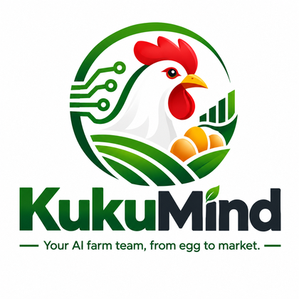

**KukuMind** is a team of **seven AI agents written in [Jac](https://jaclang.org/)** that helps medium-scale Kenyan poultry farmers (about 500–5,000 birds) **hatch, raise, protect and sell** their birds. Farm owners and workers talk to it like WhatsApp — in **English, Kiswahili or Sheng** — or use each agent's own page with forms, charts and a camera.

  

### 🚀 [Try the live demo on JacHammer](https://jachammer.ai/project/prj_12dfd0e721a247bfb46f15fca1f71e49?tab=preview)

**Live demo:** https://jachammer.ai/project/prj_12dfd0e721a247bfb46f15fca1f71e49?tab=preview · **Built by:** Meshack Mutinda · **Event:** AI Hackathon Kenya — Hack the Future with Jac (2026)

> Demo farm: **Meshack Poultry Farm** (owner Meshack, 0722 434 939) · Farm vet: **Dr. Timothy Wambua** (0714 297 727)

---

## Contents

1. [The problem](#1-the-problem)
2. [The solution in one picture](#2-the-solution-in-one-picture)
3. [The seven agents](#3-the-seven-agents)
4. [How a message flows through the team](#4-how-a-message-flows-through-the-team)
5. [The farm graph (Jac nodes and walkers)](#5-the-farm-graph-jac-nodes-and-walkers)
6. [Agent workflows](#6-agent-workflows)
7. [The maths — how every number is calculated](#7-the-maths--how-every-number-is-calculated)
8. [Safety rules built into the code](#8-safety-rules-built-into-the-code)
9. [Languages](#9-languages)
10. [The web app](#10-the-web-app)
11. [Architecture](#11-architecture)
12. [Run it yourself](#12-run-it-yourself)
13. [Testing](#13-testing)
14. [Project files](#14-project-files)

---

## 1. The problem

On Kenyan poultry farms of 500–5,000 birds:

| Problem | What it costs the farmer |
|---|---|
| 🦠 **Disease is noticed too late** | By the time many birds are dying, a whole batch can be lost. Newcastle disease can kill most of a flock in days. |
| 🌾 **Feed runs out without warning** | Feed is the biggest cost (60–70%). Running out stunts growth; wastage and theft go unseen. |
| 📓 **Records live in exercise books** | Nobody knows the true deaths, sales or profit per batch, so decisions are guesses. |
| 🗣 **Workers speak Kiswahili and Sheng** | Most farm software is English-only and needs forms that workers do not fill in. |

## 2. The solution in one picture

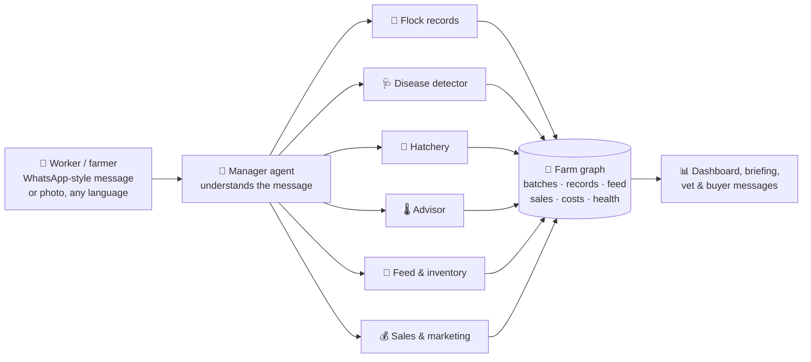

A worker just writes *"B1 leo vifo mbili, chakula gunia moja"* (B1 today: 2 deaths, 1 bag of feed). The Manager passes it to the right agent, the agent saves it in the farm graph, and every number on the farm updates — birds alive, feed left, profit, warnings.

## 3. The seven agents

| Agent | What it does | Example message |
|---|---|---|
| 🧭 **Manager** | The front door. Reads every message, sends it to the right agent, writes the morning briefing, shows today's plan and alerts. | *"Habari ya shamba leo?"* |
| 📒 **Flock records** | Saves daily reports (deaths, feed, eggs, weight), registers new flocks, keeps every bird counted. | *"Tumeleta vifaranga 500 wa broiler leo, House B"* |
| 🩺 **Disease detector** | **Diagnose** from the camera or symptoms (RED / AMBER / GREEN), **monitor** the records for early warnings, **research** diseases. Writes a ready-to-send WhatsApp message to the vet. | *"Kuku za B2 zinakohoa na zingine zimepinda shingo"* |
| 🥚 **Hatchery** | Runs the incubator: eggs set, candling day 7 and 14, lockdown day 18, hatch day 21. Hatched chicks become a new batch. | *"Nimeweka mayai 200 ya kienyeji kwa incubator"* |
| 🌡️ **Advisor** | Vaccination plan per batch (done / today / this week / later) and brooder heat by age. | *"When is the Gumboro vaccine for B1?"* |
| 🌾 **Feed & inventory** | Feed in store, days left, bags to order, expected vs used per batch (wastage or sick-bird flags), deliveries and price per kg. | *"Msosi itatosha siku ngapi?"* |
| 💰 **Sales & marketing** | Records bird and egg sales, finds what is ready for market, writes WhatsApp offers to buyers, full profit statement per batch and for the farm. | *"Sold 50 B3 layers at 450 each to Mama Njeri"* |

## 4. How a message flows through the team

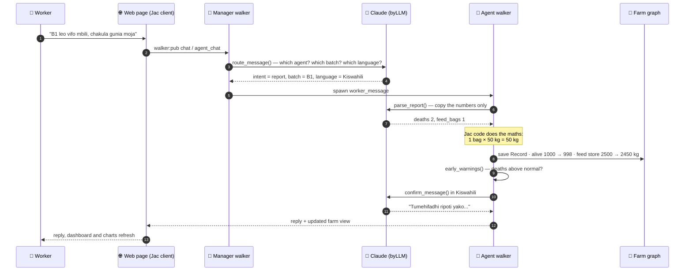

**Key design rule — "the AI reads, the code counts":** the AI only *copies* numbers out of a message (2 deaths, 1 bag, 32 trays). Jac code does every calculation (32 trays × 30 = 960 eggs), so the numbers are always exact.

### How the Manager chooses an agent

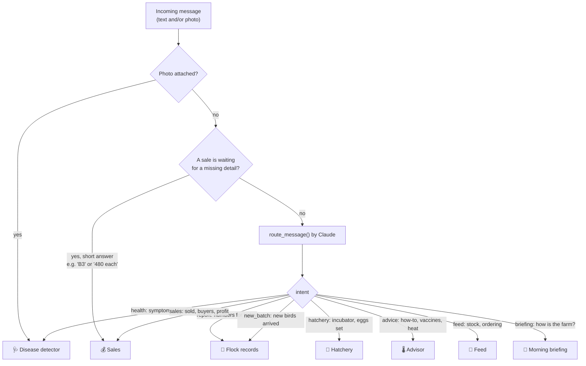

On an agent's own page, messages go **straight to that agent** (the `agent_chat` walker), so each agent works independently.

## 5. The farm graph (Jac nodes and walkers)

KukuMind uses Jac's **Object-Spatial Programming**: the farm is a graph of nodes, and each agent is a **walker** that moves through it.

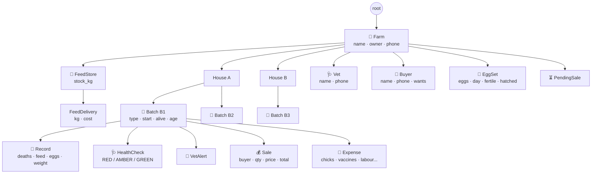

| Kind | Names |
|---|---|
| **Nodes** | Farm, House, Batch, Record, FeedStore, FeedDelivery, Vet, VetAlert, Buyer, EggSet, HealthCheck, Sale, Expense, PendingSale |
| **Agent walkers** | `kukumind` (Manager), `worker_message`, `save_report`, `add_batch`, `health_check`, `early_warning_scan`, `set_eggs`, `record_candling`, `record_hatch`, `ask_advisor`, `today_tasks`, `feed_report`, `receive_feed`, `market_alerts`, `record_sale`, `sales_report`, `vet_clear`, `morning_briefing`, `new_day` |
| **Web API walkers** (`walker:pub`) | `chat`, `agent_chat`, `farm_status`, `briefing`, `submit_report`, `register_flock`, `diagnose`, `research`, `hatchery_action`, `add_feed`, `sell`, `buyer_offers`, `add_expense`, `clear_batch`, `next_day`, `start_fresh` |
| **AI functions** (`by llm()`) | `route_message`, `parse_report`, `parse_sale`, `parse_new_batch`, `parse_hatch`, `triage_symptoms`, `triage_photo`, `research_disease`, `advise`, `farm_answer`, `write_briefing`, `buyer_broadcast`, `confirm_message`, `confirm_action`, `ask_which_batch`, `ask_sale_details` |

## 6. Agent workflows

### 🩺 Disease detector — diagnose, monitor, research

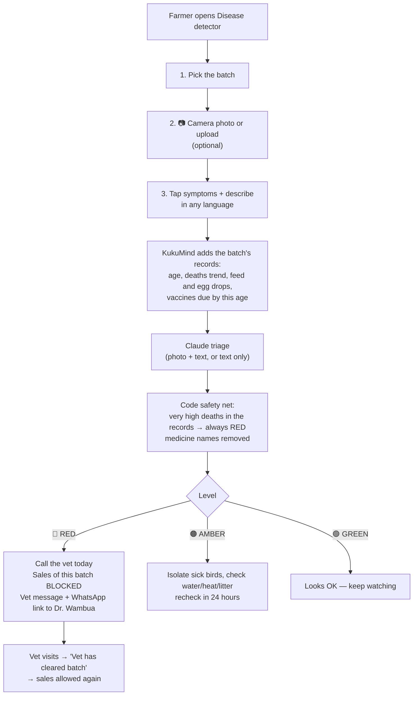

**Monitor** checks every batch after every report:

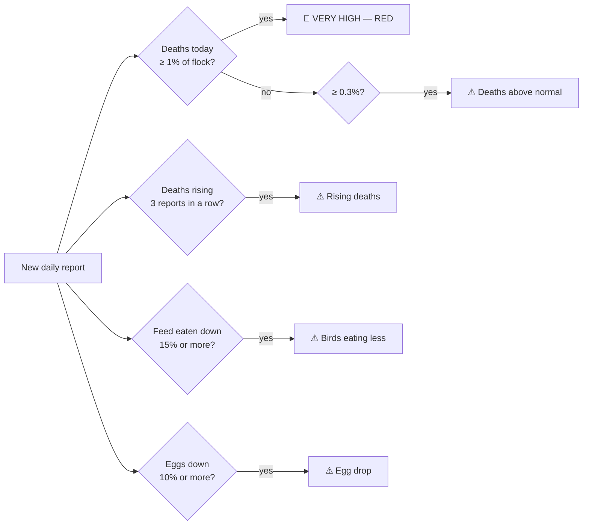

**Research** explains any disease (Newcastle, Gumboro, Coccidiosis, Fowl pox, Fowl typhoid, Bird flu, CRD, worms): signs, how it spreads, prevention, whether it is **notifiable** to the county veterinary officer, and what it means **for this farm's batches**.

### 📒 Flock records — reports and new flocks

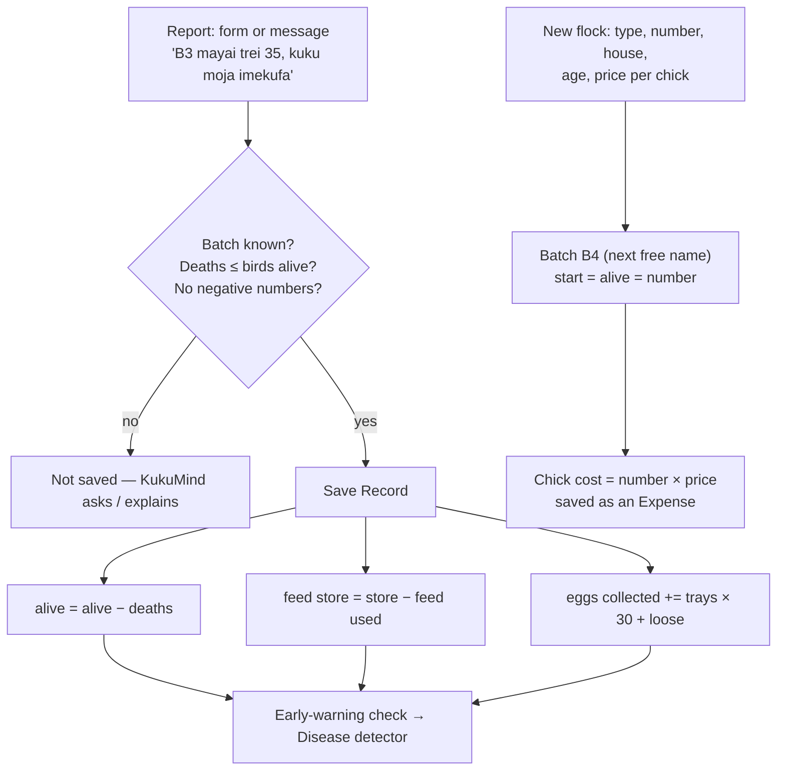

### 🥚 Hatchery — 21 days from egg to chick

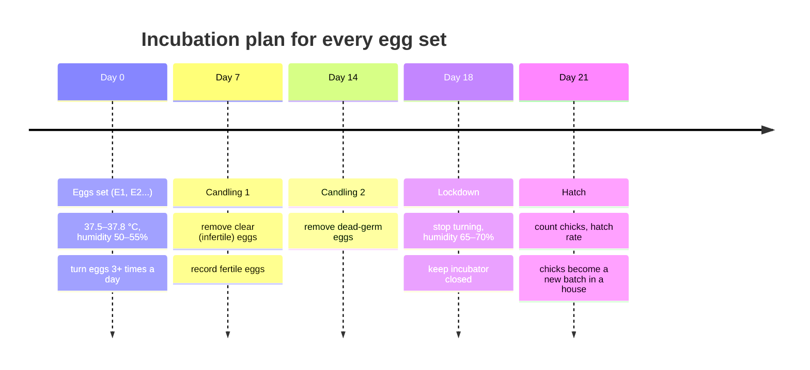

### 🌡️ Advisor — vaccination plan and heat

For every batch, the plan is calculated from its **type and age**: tasks before today are *done*, today's is *TODAY*, the next 7 days are *this week*. Brooder heat: week 1 32–35 °C, week 2 29–32 °C, week 3 26–29 °C, week 4 24–26 °C, then none for most farms. (Typical Kenyan schedule — vaccines and doses are always confirmed with the vet.)

### 🌾 Feed & inventory

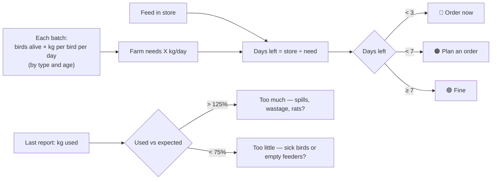

### 💰 Sales & marketing — from sale to profit

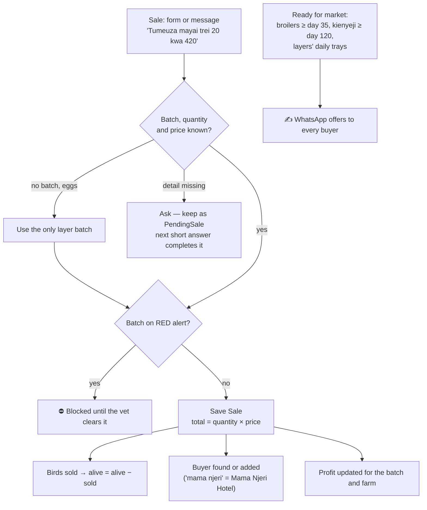

## 7. The maths — how every number is calculated

All of these are done by **Jac code**, never by the AI.

| Number | Formula |
|---|---|
| Feed in a report | `bags × 50 kg + extra kg` |
| Eggs in a report | `trays × 30 + loose eggs` |
| **Birds alive** | `start − deaths − birds sold` (checked for every batch: ✓ *Every bird is counted*) |
| Mortality | `total deaths ÷ start × 100%` |
| Feed in store | `opening stock + deliveries − feed used in reports` |
| Days of feed left | `store ÷ (Σ birds alive × kg per bird per day)` |
| Feed price per kg | `Σ delivery cost ÷ Σ delivery kg` (KSh 70 until a priced delivery is recorded) |
| Sale total | `quantity × price` (eggs: `trays × 30` eggs at `price per tray ÷ 30` each) |
| **Profit** | `bird sales + egg sales − feed eaten (kg × price/kg) − chicks − vaccines − vet − labour − transport − other` |
| Hatch rate | `chicks hatched ÷ eggs set × 100%` |

**Worked example (from the tests):**

| | KSh |
|---|---|
| Egg sales: 30 trays × 420 | 12,600 |
| Bird sales: 100 broilers × 500 | 50,000 |
| **Total sales** | **62,600** |
| Feed eaten: 140 kg × 70 | − 9,800 |
| Chicks: 500 × 110 | − 55,000 |
| Vaccines | − 4,000 |
| **Profit** | **− 6,200** (the new chicks have not been sold yet) |

## 8. Safety rules built into the code

- **Never names medicines or doses.** The AI is told not to, and code also removes any line containing a medicine name or dose before it reaches the farmer.
- **Very high deaths in the records always produce RED**, whatever the AI says.
- **A RED batch cannot be sold** until the vet clears it.
- **Newcastle disease and bird flu** are flagged as notifiable to the county veterinary officer.
- **The vet message is written by code from the records** (batch, age, deaths per day, vaccines due, symptoms) so its numbers are exact.
- Reports with more deaths than birds alive, negative numbers, or sales of 0 are **refused**.

## 9. Languages

- Workers can write in **English, Kiswahili, Sheng or a mix** (e.g. *"Manze B3 leo mayai trei thelathini na mbili, kuku moja ime-die, msosi 130kg"*).
- A **language picker** at the top of the app sets the reply language: English (default), Kiswahili, Sheng, or *Same as my message*.
- A shared **language guide** teaches number words (*thelathini na mbili* = 32), poultry words (*gunia* = 50 kg bag, *trei* = 30 eggs) and correct Kenyan Kiswahili, and bans wrong words.
- Replies are written by **Claude Sonnet 4.6**; messages are read by **Claude Haiku 4.5**. If Sonnet is not available, KukuMind switches to Haiku automatically.

## 10. The web app

- **Home:** the problem, how it works, the seven agents, and *Your farm today* (birds alive, health alerts, feed days, profit, today's plan).
- **Left menu:** Home + one page per agent (becomes a row at the top on phones).
- **Each agent page:** tabs with forms, tables and charts, plus a chat that goes straight to that agent.

| Page | Tabs |
|---|---|
| 🧭 Manager | Morning briefing · Today's plan · Dashboard · Records · team chat |
| 📒 Flock records | Daily report · New flock · Flock list · Records |
| 🩺 Disease detector | Diagnose (camera) · Monitor · Research |
| 🥚 Hatchery | Incubator · Set eggs · Hatch history |
| 🌡️ Advisor | Vaccination plan · Brooding heat |
| 🌾 Feed & inventory | Feed store · Per batch · Deliveries |
| 💰 Sales & marketing | Record a sale · Market & buyers · Profit & costs · Sales history |

Design: navy background, teal for everything you can click, gold for small highlights; works on laptop and phone.

## 11. Architecture

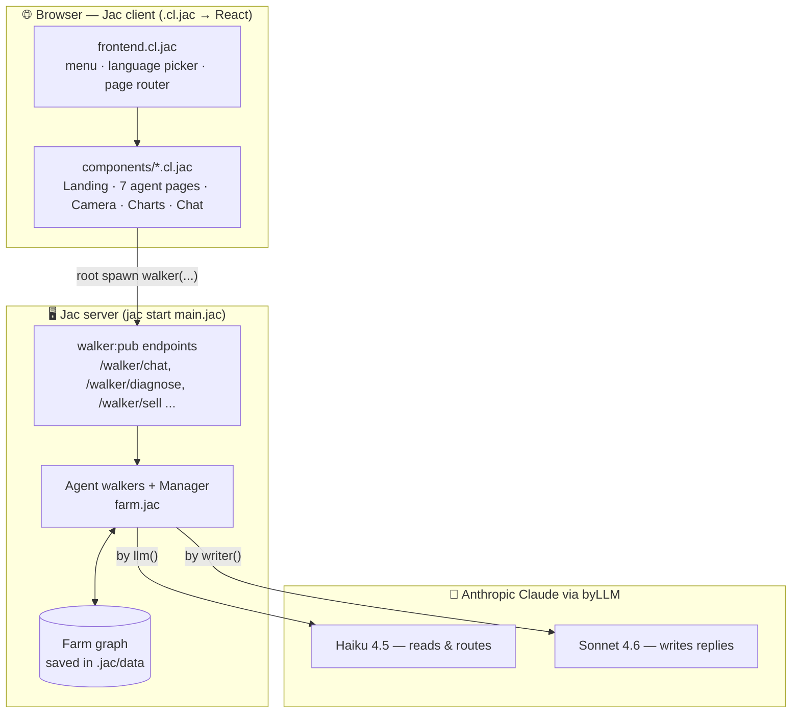

**Built with:** Jac 0.16 (jaclang), byLLM, Jac full-stack client (React), Anthropic Claude. About **98% of the code is Jac**.

## 12. Run it yourself

```bash
pip install jaclang byllm            # Jac 0.16.x
export ANTHROPIC_API_KEY=sk-ant-...  # Windows PowerShell: $env:ANTHROPIC_API_KEY="sk-ant-..."
jac start main.jac
```

Open **http://localhost:8000** — or skip the setup and use the [live demo](https://jachammer.ai/project/prj_12dfd0e721a247bfb46f15fca1f71e49?tab=preview). The first start builds the web page (about a minute).

- The farm starts **clean**: B1 1,000 broiler chicks, B2 800 broilers, B3 1,200 layers, 2,500 kg feed, no records.
- **Manager → Dashboard → Clear all records and start fresh** resets the farm.
- Terminal demo: `jac run demo.jac` (not while the web app is running).

## 13. Testing

| Test | What it checks |
|---|---|
| Automated suite (156 checks, stand-in AI) | Every walker and calculation: reports, deaths and alive, feed store, hatchery, triage safety, sale blocking, profit statement, buyers, costs, chat sale completion, language choice, clean start |
| `livetest/live_test.jac` (18 checks, real Claude) | Reading reports in English, Kiswahili and Sheng (e.g. 32 trays = 960 eggs), RED for twisted necks + rising deaths, no medicine names, correct routing to each agent, no wrong Kiswahili words |

Run the live test: `cd livetest` then `jac run live_test.jac`.

## 14. Project files

| File | Purpose |
|---|---|
| `main.jac` | Entry point: joins the server and the web page |
| `farm.jac` | The seven agents, the farm graph, the AI functions and the web API walkers |
| `frontend.cl.jac` | Web app shell: menu, language picker, page router |
| `components/` | Landing page, one page per agent, Camera, Charts, Chat, Records table, shared styles (all Jac) |
| `assets/` | KukuMind logo and browser icon |
| `demo.jac` | Terminal demo |
| `livetest/live_test.jac` | Live test with the real AI |
| `jac.toml` | Project settings |

### Language breakdown

KukuMind is written almost entirely in Jac, including the web app (Jac client components, `.cl.jac`).

| Language | Files | Size | Share of the code |
|---|---|---|---|
| **Jac** (`.jac`, `.cl.jac`) | 21 | 363,790 bytes (7,347 lines) | **99.8%** |
| TOML (`jac.toml`, settings) | 1 | 855 bytes | 0.2% |

There is no separate Python, JavaScript, HTML or CSS source: the server, the seven agents, the AI functions and the whole web page are Jac. (The README and the logo images are not code and are not counted.)

---

*KukuMind never prescribes medicine. For RED alerts, call a vet or the county veterinary officer.*
