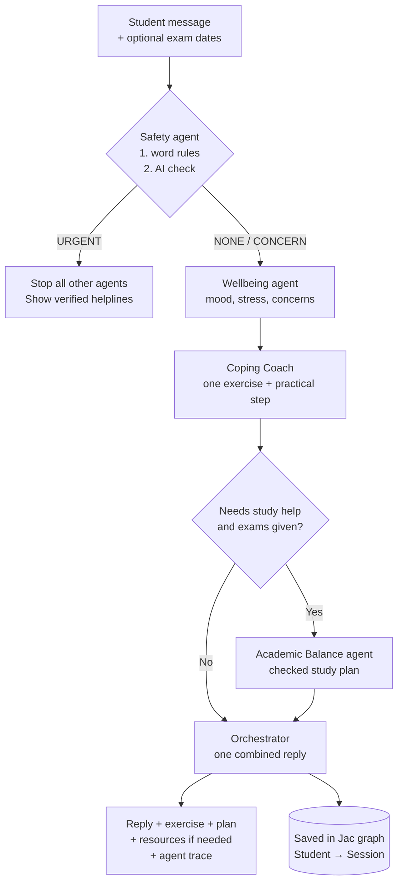
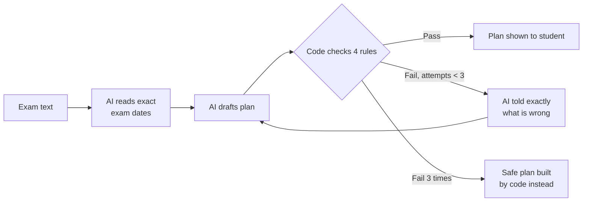

# MindMate AI

**A multi-agent student wellbeing assistant that turns overwhelm into a safe, practical next step.**

Built with [Jac / Jaseci](https://docs.jaseci.org) for the STEM2Connect AI Hackathon 2026.
**Track:** Healthcare

> MindMate is a self-help tool, not a medical or crisis service. It never diagnoses.
> If you are in danger, contact Kenya Red Cross on **1199** (free, 24/7) or emergency services on **999 / 112**.

---

## The problem

University students face exam pressure, loneliness and stress, often all at once. Most wellbeing apps only *talk* about feelings. Students also need help with the cause, such as an impossible-feeling exam schedule, and a safe route to human support when things are serious.

[Add 1–2 sentences of your own: why this matters to you and to students in Kenya.]

## What MindMate does

A student describes how they feel (and their exam dates, if relevant). Five agents work together:

| Agent | Job |
| --- | --- |
| **Safety and Support** | Runs first on every message. Plain-code checks for crisis words (English and Swahili), then an AI check for indirect signs. If a student may be at risk, everything else stops and verified Kenyan helplines are shown. |
| **Wellbeing Check-in** | Identifies mood, stress level and main concerns, reflects them back kindly and asks a gentle follow-up question. Never diagnoses. |
| **Coping Coach** | Suggests one short, gentle exercise plus one practical step that tackles the cause. |
| **Academic Balance** | Runs only when exams are part of the stress. Turns real exam dates and available hours into a day-by-day plan, then **code checks the plan** before the student sees it. |
| **Orchestrator** | Decides which agents to call, combines their results into one reply, and records an **agent trace** showing which agents ran. |

## How it works



### The study-plan checker

AI plans can contain mistakes. In testing, one plan gave a student a "free day" right before an exam. So every plan is checked by plain code:



The four rules: no day exceeds the student's available hours; every exam day has a light review; the day before each exam includes that subject; all sessions fall between today and the last exam.

### Safety by design

- Safety never depends on the AI alone: word rules run first and work even if the AI is down.
- Crisis messages and phone numbers are fixed, human-checked text, never AI-generated.
- If the AI fails, MindMate still offers support resources instead of staying silent.
- Demo scenarios use fictional students only.

## Project status

- [x] Safety and Support agent
- [x] Wellbeing Check-in agent
- [x] Coping Coach agent
- [x] Academic Balance agent with plan checker
- [x] Orchestrator with agent trace
- [ ] Web page
- [ ] Safety test report
- [ ] Replies in the student's language
- [ ] Progress tracking and replanning
- [ ] Privacy controls (nickname only, delete my data)

## How to run

Requirements: Python 3.12+, an Anthropic API key.

```bash
python -m venv jac-env
jac-env\Scripts\activate          # Windows
pip install jaseci
```

Set your key (PowerShell):

```bash
$env:ANTHROPIC_API_KEY="your-key"
$env:BYLLM_DEFAULT_MODEL="claude-sonnet-4-6"
```

Run the full system with three demo scenarios:

```bash
jac run orchestrator.jac
```

Each agent can also be tested on its own, e.g. `jac run safety_agent.jac`.

## Files

| File | Contents |
| --- | --- |
| `orchestrator.jac` | Orchestrator walker, graph (Student → Session), demo scenarios |
| `safety_agent.jac` | Safety and Support agent, verified resources |
| `wellbeing_agent.jac` | Wellbeing Check-in agent |
| `coping_agent.jac` | Coping Coach agent |
| `planner_test.jac` | Academic Balance agent and plan checker |
| `jac.toml` | Project and model settings |

## AI used

**In the app:** Anthropic Claude (`claude-sonnet-4-6`) through Jac's byLLM (`by llm()` functions with typed outputs and `sem` descriptions) powers the Wellbeing, Coping, Academic Balance and Orchestrator agents, and the second layer of the Safety agent.

**AI coding assistance:** I used Claude (Anthropic) as a tutor and coding assistant. It explained Jac concepts, drafted starter code for each agent, and helped debug errors.
[In your own words: what you typed, tested and changed yourself, e.g. ran every agent and reviewed its output, spotted the free-day bug in a real run, tested Swahili messages, adjusted `sem` descriptions.]

## Support resources (verified October 2026)

- Kenya Red Cross: **1199** (free, 24 hours)
- Befrienders Kenya: **+254 722 178 177** (call, SMS or WhatsApp, daytime hours)
- Emergency services: **999 / 112**
- Gender-based violence helpline: **1195**

## Credits

Jac / Jaseci and byLLM (Jaseci Labs), LiteLLM, Anthropic Claude API.

## What I learned

[Fill in as you go, e.g. graph thinking with nodes and walkers; meaning-typed AI functions; why code should check AI output; designing safety that does not depend on AI.]

## Next steps

[e.g. WhatsApp access, partnering with a university counselling office, testing with consenting students.]
